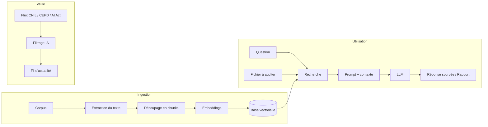

<div align="center">


# GDPR Audit

**Assistant d'audit RGPD propulsé par l'IA**

Posez vos questions, auditez vos documents, suivez la veille réglementaire.


[Présentation](#présentation) ·
[Fonctionnalités](#fonctionnalités) ·
[Architecture](#architecture) ·
[Feuille de route](#feuille-de-route) ·
[Installation](#installation)

</div>

---

## Présentation

**GDPR Audit** est un outil d'aide à la mise en conformité en matière de protection des données. Il repose sur un système de **RAG** (*Retrieval-Augmented Generation*) : les réponses de l'IA s'appuient sur un corpus de textes juridiques officiels et **citent leurs sources** (texte et article), ce qui limite les hallucinations.

La protection des données ne repose pas uniquement sur le RGPD : l'outil couvre à terme le **RGPD**, la **Loi Informatique et Libertés** et l'**AI Act**.

> **Projet d'apprentissage** : chaque brique est construite à partir de la documentation officielle, pas à pas.

---

## Fonctionnalités

<table>
<tr>
<td width="33%" valign="top">

### Veille
Dernières décisions de la **CNIL** et du **CEPD**, jurisprudence, ressources et actualité de la protection des données et de l'**AI Act**, filtrées et résumées par l'IA. Un aperçu sur l'accueil, une page dédiée pour tout consulter.

</td>
<td width="33%" valign="top">

### Audit de document
Déposez une politique de confidentialité, un contrat ou un registre de traitement : l'outil identifie les **manquements** et cite les articles concernés.

</td>
<td width="33%" valign="top">

### Chatbot juridique
Posez une question en langage naturel et obtenez une réponse **sourcée**, fondée sur les textes de référence.

</td>
</tr>
</table>

### Aperçu de l'interface

Page d'accueil (maquette Figma) :

```
┌────────────────────────────────────────────────────────────────────┐
│  [logo] Marque · signature           + Nouvelle conversation   (P) │
├────────────────────────────────────────────────────────────────────┤
│  Titre                                                             │
│  Description                                                       │
│                                                                    │
│  ┌─────────────────────────────┐  ┌─────────────────────────────┐  │
│  │ Actualités juridiques  Voir │  │ Vos documents     0 fichier │  │
│  │ CNIL · Titre de l'article > │  │  ┌───────────────────────┐  │  │
│  │ Résumé…                     │  │  │  Déposer un fichier   │  │  │
│  │ CEPD · Titre de l'article > │  │  │  ou parcourir         │  │  │
│  │ Résumé…                     │  │  └───────────────────────┘  │  │
│  └─────────────────────────────┘  └─────────────────────────────┘  │
│                                                                    │
│  ┌──────────────────────────────────────────────────────────────┐  │
│  │ Conversation                                                 │  │
│  │        Comment puis-je vous aider ?                          │  │
│  │   [ suggestion ]  [ suggestion ]  [ suggestion ]             │  │
│  │  [ (trombone)  Posez votre question…           Envoyer ↑ ]   │  │
│  └──────────────────────────────────────────────────────────────┘  │
└────────────────────────────────────────────────────────────────────┘
```

Page 2 : **Veille** en grand (plus d'articles, jurisprudence et ressources), accessible via « Voir plus ».

---

## Corpus de référence

| Texte | Fichier | Pages | Version |
|---|---|:-:|:-:|
| RGPD (règlement (UE) 2016/679) — EUR-Lex | `corpus/RGPD.pdf` | 88 | V1 |
| Loi Informatique et Libertés (loi n° 78-17) — Légifrance | `corpus/LIL.pdf` | 62 | V2 |
| AI Act (règlement (UE) 2024/1689) — EUR-Lex | `corpus/IA_Act.pdf` | 144 | V3 |
| Lignes directrices et recommandations — CEPD | — | — | Plus tard |
| Référentiels et recommandations — CNIL | — | — | Plus tard |

Les trois premiers textes sont déjà dans le dépôt et extraits par `open_pdf.py` (294 pages au total). Le RAG est d'abord construit de bout en bout sur le **RGPD seul**, avec une architecture **multi-sources dès le départ** : chaque morceau de texte garde sa source.

---

## Architecture



### Structure du projet

```
GDPR_AUDIT_V2/
├── assets/          logo
├── corpus/          textes de référence (PDF)
├── figma/           exports de la maquette
├── scripts/
│   ├── open_pdf.py      lecture des PDF → pages {numero, texte, source}
│   ├── indexer.py       découpage en chunks → embeddings → base vectorielle
│   ├── rag.py           recherche des passages + appel au LLM
│   ├── chat_bot.py      gestion de la conversation
│   ├── audit.py         audit d'un document déposé
│   ├── veille.py        collecte des actualités
│   ├── filtre_ia.py     filtrage et résumé des actualités
│   ├── prompts.py       prompts envoyés au LLM
│   ├── config.py        configuration (chemins, modèles…)
│   ├── api.py           routes /chat, /audit, /news
│   └── dashboard.py     interface
└── tests/
```

| Bloc | Rôle |
|---|---|
| **Ingestion** | Lire les documents, les découper et les transformer en vecteurs |
| **RAG** | Retrouver les passages pertinents et générer une réponse sourcée |
| **Audit** | Confronter un document déposé au corpus et produire un rapport |
| **Veille** | Collecter, filtrer et résumer l'actualité réglementaire |
| **API** | Exposer les routes `/chat`, `/audit` et `/news` |
| **Front** | Interface conçue sur Figma |

### Stratégie de découpage (chunking)

**Recursive chunking structurel, aligné sur les articles, enrichi d'un en-tête de contexte :**

1. Découper chaque texte **par article** (« Article X »).
2. Si un article est trop long, le **redécouper** par paragraphe (`1.`, `2.`…), puis par phrase, avec un léger **overlap**.
3. Ajouter en tête de chaque morceau un **en-tête de contexte**, par exemple `[RGPD – Article 6 : Licéité du traitement]`.
4. Conserver en métadonnées : source, article, page.

Pourquoi : un article est une unité de sens définie par le législateur, et le découpage par article permet de **citer précisément** (« RGPD, article 6 ») au lieu d'un numéro de page.

### Décisions prises

- [x] **Périmètre** : V1 = RGPD, V2 = Loi Informatique et Libertés, V3 = audit AI Act (grille par niveau de risque)
- [x] **Lecture des PDF** : `pdfplumber`
- [x] **Chunking** : recursive structurel par article + en-tête de contexte (voir ci-dessus)

### Décisions à prendre

- [ ] **Stack front** : Streamlit/Gradio (rapide) ou FastAPI + front séparé (fidèle à la maquette)
- [ ] **Fichier audité** : ajouté au corpus ou traité à part ?
- [ ] **Dépôt de fichier** : zone de dépôt et trombone du chat, même rôle ou deux usages différents ?
- [ ] **Comptes et historique** : bouton Profil et « Nouvelle conversation » nécessaires en V1 ? (implique authentification et stockage de données personnelles)
- [ ] **Texte de référence** : l'utilisateur choisit-il le texte (RGPD, LIL, AI Act) ou l'outil détermine-t-il seul les textes applicables ?
- [ ] **Rôles** : différence entre `chat_bot.py` et `rag.py`
- [ ] **Modèles** : choix du LLM et du modèle d'embeddings
- [ ] **Stockage** : choix de la base vectorielle (ex. ChromaDB)

---

## Feuille de route

### Versions

| Version | Périmètre | Statut |
|:-:|---|:-:|
| V1 | RAG complet sur le **RGPD** | En cours |
| V2 | Ajout de la **Loi Informatique et Libertés** | À faire |
| V3 | **Audit AI Act** : qualification du système, niveau de risque, obligations selon le rôle | À faire |

### Phases

| | Phase | Statut |
|:-:|---|:-:|
| 0 | Mise en place du projet | Presque terminé |
| 1 | Conception sur papier | À faire |
| 2 | Maquette Figma | En cours |
| 3 | Ingestion du corpus | En cours |
| 4 | RAG en ligne de commande | À faire |
| 5 | Audit de document | À faire |
| 6 | Veille réglementaire | À faire |
| 7 | API | À faire |
| 8 | Maquette Figma finale | À faire |
| 9 | Front | À faire |
| 10 | Finitions | À faire |

<details>
<summary><b>Phase 0 : Mise en place du projet</b></summary>

- [x] Créer le dépôt GitHub
- [x] Relier le dossier local au dépôt
- [x] Créer le `.gitignore` (`.env`, environnement virtuel, base vectorielle, fichiers déposés, fichiers Figma lourds)
- [x] Créer un environnement virtuel Python (`.venv`)
- [x] Transformer `corpus` en dossier
- [x] Organiser l'arborescence par bloc logique (`scripts/`, `tests/`, `corpus/`)
- [x] Renommer les fichiers selon la PEP 8
- [ ] Créer `requirements.txt` ou `pyproject.toml`
- [ ] Créer `.env` pour les clés d'API (jamais commité) et `.env.example`

*Docs : PEP 8 (Naming Conventions), `venv`, Git*
</details>

<details>
<summary><b>Phase 1 : Conception sur papier</b></summary>

- [ ] Lister les parcours utilisateur : poser une question, déposer un fichier, consulter une news
- [ ] Pour chaque parcours, définir ce que l'utilisateur envoie et ce qu'il reçoit
- [ ] Définir le format du rapport d'audit (score ? manquements ? articles cités ?)
</details>

<details>
<summary><b>Phase 2 : Maquette Figma</b></summary>

- [x] Page d'accueil : navigation, actualités, dépôt de fichiers, conversation
- [x] Page Veille (page 2)
- [ ] Donner plus de place au chat (zone principale de l'outil)
- [ ] Remplacer les hauteurs fixes par « Fill container » / « Hug contents »
- [ ] Ajouter les états : fichier déposé, analyse en cours, rapport, conversation en cours, erreur
- [ ] Relier les pages en mode Prototype (« Voir plus » → page Veille)
- [ ] Choisir la stack front à partir de la maquette

*Docs : help.figma.com (Auto Layout, Resizing in auto layout, Prototyping)*
</details>

<details>
<summary><b>Phase 3 : Ingestion du corpus</b></summary>

- [x] Réunir les textes de référence dans `corpus/` (RGPD, LIL, AI Act)
- [x] Extraire le texte des PDF page par page avec numéro et source (`open_pdf.py`)
- [x] Extraire tout le dossier en une seule liste de pages (`extraction_corpus`)
- [ ] `open_pdf.py` : gérer les pages sans texte (`None`) et le fichier introuvable (`try / except`)
- [ ] Observer comment apparaissent les articles, paragraphes et points dans le texte extrait
- [ ] Découper par article avec les expressions régulières (module `re`)
- [ ] Redécouper les articles trop longs (paragraphe, puis phrase) avec overlap
- [ ] Ajouter l'en-tête de contexte et les métadonnées (source, article, page)
- [ ] Générer les embeddings et les stocker dans la base vectorielle

*Docs : RAG chunking strategies, chunk overlap, Contextual Retrieval, module `re`, ChromaDB*
</details>

<details>
<summary><b>Phase 4 : RAG en ligne de commande</b></summary>

- [ ] Rechercher les chunks les plus proches d'une question
- [ ] Construire le prompt (instructions + contexte + question)
- [ ] Appeler le LLM et afficher la réponse avec ses sources (texte + article)
- [ ] Tester sur une dizaine de questions dont la réponse est connue
- [ ] Plus tard : gérer les renvois entre articles (ex. l'article 9 qui renvoie à l'article 6)

*Docs : fournisseur du LLM, prompt engineering, RAG evaluation*
</details>

<details>
<summary><b>Phase 5 : Audit de document</b></summary>

- [ ] Extraire le contenu du fichier déposé
- [ ] Définir une grille d'audit RGPD (bases légales, conservation, droits des personnes, transferts hors UE…)
- [ ] Confronter chaque point de la grille au corpus via le RAG
- [ ] Générer un rapport structuré
- [ ] V2 : spécificités françaises de la LIL
- [ ] V3 : grille AI Act (système d'IA ? niveau de risque ? rôle fournisseur / déployeur ? obligations)
</details>

<details>
<summary><b>Phase 6 : Veille réglementaire</b></summary>

- [ ] Identifier les flux RSS de la CNIL, du CEPD et des sources AI Act
- [ ] Ajouter la jurisprudence (CJUE, Conseil d'État, Cour de cassation) et les ressources (guides CNIL…)
- [ ] Pour les sources sans flux RSS : étudier le scraping (conditions d'utilisation, `robots.txt`)
- [ ] Récupérer et normaliser les articles (rubrique, titre, résumé, date, source, lien)
- [ ] Filtrer et résumer les articles avec l'IA
- [ ] Une seule source de données pour l'aperçu de l'accueil et la page Veille
- [ ] Mettre les résultats en cache

*Docs : `feedparser`, cnil.fr, edpb.europa.eu*
</details>

<details>
<summary><b>Phase 7 : API</b></summary>

- [ ] Exposer `/chat`, `/audit` (upload de fichier) et `/news`
- [ ] Gérer les erreurs et valider les entrées
- [ ] Tester les routes avec la doc interactive

*Docs : tutoriel FastAPI, section Request Files*
</details>

<details>
<summary><b>Phase 8 : Maquette Figma finale</b></summary>

- [ ] Définir la palette, la typographie et les espacements (Variables)
- [ ] Harmoniser l'emblème de la maquette avec le logo du dépôt
- [ ] Créer les composants : carte de news, bulle de chat, zone de dépôt, suggestion, rapport
- [ ] Vérifier les contrastes et les tailles de texte (accessibilité)
- [ ] Préparer la maquette pour le Dev Mode

*Docs : help.figma.com (Components, Variables, Dev Mode), WebAIM Contrast Checker*
</details>

<details>
<summary><b>Phase 9 : Front</b></summary>

- [ ] Reproduire la maquette (icônes : bibliothèque Lucide)
- [ ] Connecter le front à l'API
- [ ] Gérer les états de chargement et d'erreur
</details>

<details>
<summary><b>Phase 10 : Finitions</b></summary>

- [ ] Ajouter des tests sur l'ingestion, le RAG et l'API
- [ ] Noms lisibles pour les sources (ex. `LIL` → « Loi Informatique et Libertés ») dans `config.py`
- [ ] Afficher un avertissement juridique dans l'interface
- [ ] Vérifier la conformité RGPD de l'outil lui-même (destination et durée de conservation des fichiers déposés)
- [ ] Rédiger la documentation d'installation et d'utilisation
</details>

---

## Installation

```bash
git clone https://github.com/Leo-TRS/GDPR_auditor_V2.git
cd GDPR_auditor_V2
python3 -m venv .venv
source .venv/bin/activate
pip install pdfplumber
```

Tester l'extraction du corpus :

```bash
python scripts/open_pdf.py
```

*Section complétée au fil du développement (un `requirements.txt` est prévu).*

---

## Avertissement

Cet outil est une **aide à l'analyse** et ne constitue **pas un conseil juridique**. Ses résultats doivent être vérifiés par un professionnel qualifié (DPO, juriste, avocat).
