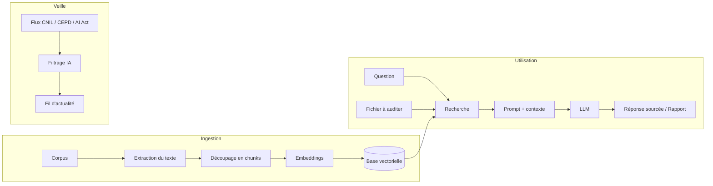

<div align="center">


# GDPR Audit

**Assistant d'audit RGPD propulsé par l'IA**

Posez vos questions, auditez vos documents, suivez la veille réglementaire.


[Présentation](#présentation) ·
[Fonctionnalités](#fonctionnalités) ·
[Architecture](#architecture) ·
[Feuille de route](#feuille-de-route) ·
[Installation](#installation)

</div>

---

## Présentation

**GDPR Audit** est un outil d'aide à la mise en conformité RGPD. Il repose sur un système de **RAG** (*Retrieval-Augmented Generation*) : les réponses de l'IA s'appuient sur un corpus de textes juridiques officiels et **citent leurs sources**, ce qui limite les hallucinations.

> **Projet d'apprentissage** : chaque brique est construite à partir de la documentation officielle, pas à pas.

---

## Fonctionnalités

<table>
<tr>
<td width="33%" valign="top">

### Veille
Dernières décisions de la **CNIL** et du **CEPD**, et actualité de la protection des données et de l'**AI Act**, filtrées et résumées par l'IA.

</td>
<td width="33%" valign="top">

### Audit de document
Déposez une politique de confidentialité, un contrat ou un registre de traitement : l'outil identifie les **manquements** et cite les articles concernés.

</td>
<td width="33%" valign="top">

### Chatbot RGPD
Posez une question en langage naturel et obtenez une réponse **sourcée**, fondée sur les textes de référence.

</td>
</tr>
</table>

### Aperçu de l'interface

```
┌──────────────────────┬────────────────────────────────────────────┐
│  VEILLE              │                                            │
│  • Décision CNIL …   │                                            │
│  • Avis CEPD …       │                CHATBOT RGPD                │
│  • AI Act …          │                                            │
├──────────────────────┤   > Quelle base légale pour la prospection │
│  AUDIT               │     commerciale par e-mail ?               │
│                      │                                            │
│   ┌──────────────┐   │   Réponse sourcée … [Art. 6 RGPD]          │
│   │ Déposer un   │   │                                            │
│   │   fichier    │   │                                            │
│   └──────────────┘   │   [ Posez votre question…           > ]    │
└──────────────────────┴────────────────────────────────────────────┘
```

*Maquette détaillée en cours de conception sur Figma.*

---

## Corpus de référence

| Texte | Source |
|---|---|
| RGPD (règlement (UE) 2016/679) | EUR-Lex |
| Loi Informatique et Libertés | Légifrance |
| Lignes directrices et recommandations | CEPD |
| Référentiels et recommandations | CNIL |
| AI Act (règlement (UE) 2024/1689) | EUR-Lex |

---

## Architecture



| Bloc | Rôle |
|---|---|
| **Ingestion** | Lire les documents, les découper et les transformer en vecteurs |
| **RAG** | Retrouver les passages pertinents et générer une réponse sourcée |
| **Audit** | Confronter un document déposé au corpus et produire un rapport |
| **Veille** | Collecter, filtrer et résumer l'actualité réglementaire |
| **API** | Exposer les routes `/chat`, `/audit` et `/news` |
| **Front** | Interface conçue sur Figma |

### Décisions à prendre

- [ ] **Stack front** : Streamlit/Gradio (rapide) ou FastAPI + front séparé (fidèle à la maquette)
- [ ] **Fichier audité** : ajouté au corpus ou traité à part ?
- [ ] **Rôles** : différence entre `chat_bot.py` et `rag.py`
- [ ] **Modèles** : choix du LLM et du modèle d'embeddings
- [ ] **Stockage** : choix de la base vectorielle (ex. ChromaDB)

---

## Feuille de route

| | Phase | Statut |
|:-:|---|:-:|
| 0 | Mise en place du projet | En cours |
| 1 | Conception sur papier | À faire |
| 2 | Wireframe Figma | À faire |
| 3 | Ingestion du corpus | À faire |
| 4 | RAG en ligne de commande | À faire |
| 5 | Audit de document | À faire |
| 6 | Veille réglementaire | À faire |
| 7 | API | À faire |
| 8 | Maquette Figma finale | À faire |
| 9 | Front | À faire |
| 10 | Finitions | À faire |

<details>
<summary><b>Phase 0 : Mise en place du projet</b></summary>

- [x] Créer le dépôt GitHub
- [x] Relier le dossier local au dépôt
- [ ] Créer le `.gitignore` (exclure `.env`, l'environnement virtuel et la base vectorielle)
- [ ] Créer un environnement virtuel Python
- [ ] Créer `requirements.txt` ou `pyproject.toml`
- [ ] Créer `.env` pour les clés d'API (jamais commité)
- [ ] Transformer `corpus` en dossier
- [ ] Organiser l'arborescence par bloc logique
- [ ] Renommer les fichiers selon la PEP 8

*Docs : PEP 8 (Naming Conventions), `venv`, Git*
</details>

<details>
<summary><b>Phase 1 : Conception sur papier</b></summary>

- [ ] Lister les parcours utilisateur : poser une question, déposer un fichier, consulter une news
- [ ] Pour chaque parcours, définir ce que l'utilisateur envoie et ce qu'il reçoit
- [ ] Définir le format du rapport d'audit (score ? manquements ? articles cités ?)
</details>

<details>
<summary><b>Phase 2 : Wireframe Figma</b></summary>

- [ ] Dessiner les 3 zones avec des boîtes grises, sans couleur
- [ ] Prévoir les états : vide, chargement, erreur, résultat
- [ ] Choisir la stack front à partir du wireframe

*Docs : help.figma.com (Frames, Auto Layout)*
</details>

<details>
<summary><b>Phase 3 : Ingestion du corpus</b></summary>

- [ ] Réunir les textes de référence dans `corpus/`
- [ ] Extraire le texte des PDF
- [ ] Découper le texte en chunks en conservant les métadonnées (source, article, page)
- [ ] Générer les embeddings et les stocker dans la base vectorielle

*Docs : chunking strategies, ChromaDB, librairie PDF choisie*
</details>

<details>
<summary><b>Phase 4 : RAG en ligne de commande</b></summary>

- [ ] Rechercher les chunks les plus proches d'une question
- [ ] Construire le prompt (instructions + contexte + question)
- [ ] Appeler le LLM et afficher la réponse avec ses sources
- [ ] Tester sur une dizaine de questions dont la réponse est connue

*Docs : fournisseur du LLM, prompt engineering, RAG evaluation*
</details>

<details>
<summary><b>Phase 5 : Audit de document</b></summary>

- [ ] Extraire le contenu du fichier déposé
- [ ] Définir une grille d'audit (bases légales, conservation, droits des personnes, transferts hors UE…)
- [ ] Confronter chaque point de la grille au corpus via le RAG
- [ ] Générer un rapport structuré
</details>

<details>
<summary><b>Phase 6 : Veille réglementaire</b></summary>

- [ ] Identifier les flux RSS de la CNIL, du CEPD et des sources AI Act
- [ ] Récupérer et normaliser les articles (titre, date, source, lien)
- [ ] Filtrer et résumer les articles avec l'IA
- [ ] Mettre les résultats en cache

*Docs : `feedparser`, cnil.fr, edpb.europa.eu*
</details>

<details>
<summary><b>Phase 7 : API</b></summary>

- [ ] Exposer `/chat`, `/audit` (upload de fichier) et `/news`
- [ ] Gérer les erreurs et valider les entrées
- [ ] Tester les routes avec la doc interactive

*Docs : tutoriel FastAPI, section Request Files*
</details>

<details>
<summary><b>Phase 8 : Maquette Figma finale</b></summary>

- [ ] Définir la palette, la typographie et les espacements
- [ ] Créer les composants : carte de news, bulle de chat, zone de dépôt, rapport
- [ ] Préparer la maquette pour le Dev Mode

*Docs : help.figma.com (Components, Variables, Dev Mode)*
</details>

<details>
<summary><b>Phase 9 : Front</b></summary>

- [ ] Reproduire la maquette
- [ ] Connecter le front à l'API
- [ ] Gérer les états de chargement et d'erreur
</details>

<details>
<summary><b>Phase 10 : Finitions</b></summary>

- [ ] Ajouter des tests sur l'ingestion, le RAG et l'API
- [ ] Afficher un avertissement juridique dans l'interface
- [ ] Vérifier la conformité RGPD de l'outil lui-même (destination et durée de conservation des fichiers déposés)
- [ ] Rédiger la documentation d'installation et d'utilisation
</details>

---

## Installation

*Section à compléter au fil du développement.*

---

## Avertissement

Cet outil est une **aide à l'analyse** et ne constitue **pas un conseil juridique**. Ses résultats doivent être vérifiés par un professionnel qualifié (DPO, juriste, avocat).
